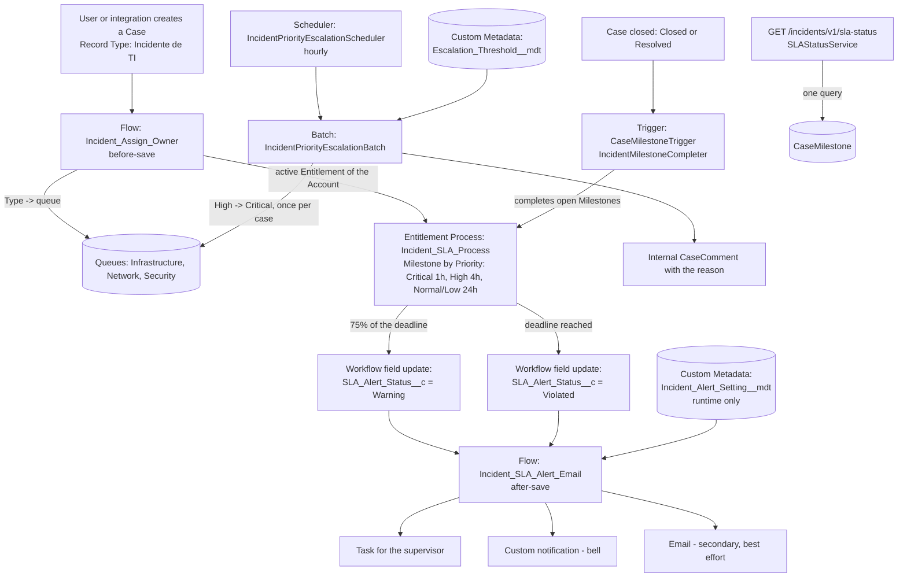

# Incident SLA Manager

IT incident management on Salesforce Service Cloud for a large company: incidents are **routed automatically** to the right team queue, covered by an **SLA with Entitlements and Milestones**, **alerted** on through several channels, **escalated** when a team is overloaded, and exposed through a **REST API** for dashboards.

The goal of the project is to show a complete design, not just configuration: declarative Flow where it is enough, Apex where it is not, and automated tests for the Apex.

## The problem

An IT service desk receives incidents that must reach the right team (Infrastructure, Network, Security), be resolved within a time that depends on how critical they are, and never be forgotten:

- someone has to **assign** each incident to the right queue, with no manual triage;
- each incident needs a **deadline** (Critical 1 h, High 4 h, Normal and Low 24 h) and a **warning at 75%** of it, plus an action when it is **violated**;
- alerts must **reach a supervisor reliably**, even if one channel fails;
- when one team is **flooded** with Critical and High incidents, the oldest High ones must be raised to Critical, once, with an audit trail;
- management needs to **read the SLA situation** from outside Salesforce.

## Architecture



## Components

| Area | Component | What it does |
|---|---|---|
| Data model | Record Type `Incident_IT` ("Incidente de TI"), Support Process `Incident_Process` | Isolates incidents from other Cases; adds the `Resolved` status |
| | `Priority` (Critical, High, Normal, Low), `Type` (Infrastructure, Network, Security) | Standard picklists extended; the Record Type only shows the new values |
| | `Routing_Note__c`, `SLA_Alert_Status__c` (history tracked), `Last_Escalated_At__c` | Audit of routing decisions and failures; SLA alert state; escalation marker |
| | Queues `Infrastructure_Queue`, `Network_Queue`, `Security_Queue` | One per team |
| | Permission set `Incident_Manager` | Object, field, Record Type and Apex class access |
| Assignment | Flow `Incident_Assign_Owner` (record-triggered, before-save, create) | Owner = queue by Type (empty Type goes to Infrastructure and is noted); links the Account's active Entitlement; failures go to `Routing_Note__c` |
| SLA | `Incident_SLA_Process` (Entitlement Process), Milestone Type `Incident_Resolution`, Business Hours "Default" (24x7) | One Milestone per Priority with a 75% warning action and a violation action |
| | Workflow field updates `Incident_SLA_Set_Warning` / `Incident_SLA_Set_Violated` | The only action type a Milestone can run here; they bridge to the Flow |
| | `Incident_SLA_Test_Process` | **Test only**: a 4-minute Milestone to see the SLA behaviour quickly |
| | Trigger `CaseMilestoneTrigger` + `IncidentMilestoneCompleter` | Completes open Milestones when a case is closed |
| Alerts | Flow `Incident_SLA_Alert_Email` (after-save) | Task + custom notification + email to the supervisor; each channel has its own fault path |
| | Custom Notification Type `Incident_SLA_Alert` | The bell notification |
| | Custom Metadata `Incident_Alert_Setting__mdt` | Supervisor username and optional email; **set at runtime, never committed** |
| Escalation | `IncidentPriorityEscalationBatch`, `IncidentPriorityEscalationScheduler` | Per queue, raises the oldest High incidents to Critical when Critical + High exceeds the limit |
| | Custom Metadata `Escalation_Threshold__mdt` | Limit per queue (record name = queue developer name) or `Default` (ships with 10) |
| API | `SLAStatusService` (`@RestResource`) | SLA counts by Type |
| Tests | `IncidentMilestoneCompleterTest`, `IncidentPriorityEscalationBatchTest`, `SLAStatusServiceTest`, `SLAStatusServiceIntegrationTest`, `IncidentTestUtil` | See "How to test" |
| Scripts | `scripts/apex/*.apex` | Seed data, supervisor configuration, scheduling, manual flow test |

## Design decisions: why Flow here and Apex there

- **Assignment is a before-save Flow.** It only sets fields on the record being created (owner, entitlement, note), so before-save needs no extra DML and is the cheapest option. Two Get Records (queue, entitlement) are batched by the Flow engine: 200 cases created in one transaction were assigned correctly using 2 SOQL queries.
- **Alerts are a record-triggered Flow, bridged by a field.** A Milestone action can only be a workflow action (field update, email alert, task, outbound message), not a Flow. The two actions set `SLA_Alert_Status__c`, and the Flow reacts to that change. Task, notification and email are all declarative, configurable by an admin, and independent of each other.
- **Milestone completion is Apex.** A Flow would have to update `CaseMilestone` records per case; the trigger does it with one query and one DML for any number of closed cases.
- **Escalation is Apex Batch.** It needs a cross-record decision (rank the oldest High cases of each queue against a limit), runs on a schedule, must write audit comments and must respect user permissions: `with sharing`, `WITH USER_MODE` and `AccessLevel.USER_MODE`. The plan is computed once in `start()` with a single query; `execute()` (scope 200) only updates the chosen cases. Each case is escalated at most once (`Last_Escalated_At__c`), only High to Critical, and never more than the queue's excess.
- **The API is Apex** because a Flow cannot expose an HTTP endpoint. It reads `CaseMilestone` with one query and does the 75% maths in memory, because SOQL cannot compute a ratio per row.
- **Configuration lives in Custom Metadata**, not in code: the escalation limit per queue and the alert recipient.
- **The API groups by `Case.Type`, not by owner.** A case's owner changes from the queue to a person when a technician picks it up, so owner-based counts would move cases out of the queue figures. Type is stable.

## Install and configure

Requirements: Salesforce CLI, a Developer Edition (or sandbox) with **Entitlement Management enabled** (Setup > Entitlement Settings) and an authenticated org alias (`<ORG_ALIAS>`).

> The order below is the one used while building in a Developer Edition. A full install into a brand-new org has not been run end to end.

```bash
# 1. Status values first: the support process references "Resolvido"
sf project deploy start -o <ORG_ALIAS> -d force-app/main/default/standardValueSets

# 2. Everything else, running the Apex tests
sf project deploy start -o <ORG_ALIAS> -d force-app -l RunLocalTests

# 3. Seed data (fictional Account and Entitlement, queue membership of the running user)
sf apex run -f scripts/apex/seed-data.apex -o <ORG_ALIAS>

# 4. Link the Entitlements to the SLA processes and create the test account for the 4-minute process
sf apex run -f scripts/apex/seed-sla-test.apex -o <ORG_ALIAS>

# 5. Assign the permission set to whoever will work with incidents
sf org assign permset -n Incident_Manager -o <ORG_ALIAS> --on-behalf-of <USERNAME>

# 6. Alert recipient (see below), then schedule the escalation batch
sf apex run -f scripts/apex/set-supervisor-email.apex -o <ORG_ALIAS>
sf apex run -f scripts/apex/schedule-escalation.apex -o <ORG_ALIAS>
```

- **Supervisor (step 6).** Edit `supervisorUsername` (receives the Task and the bell notification) and, optionally, `supervisorEmail` in `scripts/apex/set-supervisor-email.apex` locally and run it. The `Default` record of `Incident_Alert_Setting__mdt` is listed in `.forceignore`, so a retrieve can never pull a real address into the repository. Do not commit the edited script.
- **Escalation limit.** Edit the `Default` record of `Escalation_Threshold__mdt`, or add a record named after a queue developer name (for example `Network_Queue`) to override one queue.
- **Email deliverability.** Setup > Deliverability must allow email (see Known issues).

## How to test

```bash
# All Apex tests with coverage
sf apex run test -o <ORG_ALIAS> --test-level RunLocalTests --code-coverage --result-format human -w 15
```

Last run in the development org: **35 tests (including the Case Classifier's), all passing, 97% org-wide coverage**.

| Class | Coverage |
|---|---|
| `SLAStatusService` | 100% |
| `IncidentMilestoneCompleter` | 100% |
| `IncidentPriorityEscalationScheduler` | 100% |
| `CaseMilestoneTrigger` | 100% |
| `IncidentPriorityEscalationBatch` | 94% (the uncovered lines are defensive branches, such as save failures) |

- **Escalation batch**: 200 cases in one queue with a limit of 150 raise exactly 50, with 50 internal comments, one execute scope and no Case Classifier jobs; already-escalated cases are ignored; only High becomes Critical; the limit is per queue; the Custom Metadata default is used when there is no override; the scheduler registers its job and launches the batch.
- **Milestone completion**: 200 closed cases complete 200 Milestones, with a small, constant number of queries.
- **API**: `SLAStatusServiceTest` checks classification and aggregation with **in-memory rows** (no Entitlement Process needed) and the REST handler for 200, 403 and 500. `SLAStatusServiceIntegrationTest` creates 200 real cases and moves the clock to check each SLA state; **it depends on the deployed `Incident_SLA_Test_Process`, the `Incident_Manager` permission set and the `Incident_Assign_Owner` flow**.
- **Test users.** Tests that create incidents run as a dedicated user holding `Incident_Manager` (`IncidentTestUtil`), because the Record Type and some fields are only accessible with that permission set. No test uses `SeeAllData=true`.

Manual checks:

- **Routing**: with the permission set assigned, `sf apex run -f scripts/apex/test-assign-flow.apex -o <ORG_ALIAS>` creates 4 cases (one per type, one without Type) and 200 in bulk and prints owner and entitlement of each. It leaves test data in the org.
- **SLA in minutes instead of hours**: create an Account Entitlement linked to `Incident_SLA_Test_Process` (done by step 4) and open a case on the "Conta Teste SLA Rápido" account. The Milestone lasts 4 minutes: the Warning action runs at about 3 minutes and Violated at 4, both at the next `:59` second of the minute (the SLA engine ticks once a minute), creating the Task and the notification and attempting the email.

## REST API

`GET /services/apexrest/incidents/v1/sla-status` returns counts of open IT incidents by SLA state, grouped by `Case.Type`. It never returns Subject, names, emails or owners. Authentication is the standard Salesforce OAuth bearer token; the caller needs the `Incident_Manager` permission set.

```bash
curl -s -H "Authorization: Bearer <ACCESS_TOKEN>" \
     "<ORG_URL>/services/apexrest/incidents/v1/sla-status"
```

Example response (fictional data):

```json
{
  "generated_at": "2026-10-18T17:54:30.982Z",
  "truncated": false,
  "groups": [
    { "type": "Infrastructure", "queue": "Infrastructure_Queue", "within_sla": 12, "near_breach": 3, "breached": 1, "total_open": 16, "no_sla": 2 },
    { "type": "Network",        "queue": "Network_Queue",        "within_sla": 5,  "near_breach": 0, "breached": 0, "total_open": 5,  "no_sla": 0 },
    { "type": "Security",       "queue": "Security_Queue",       "within_sla": 2,  "near_breach": 1, "breached": 2, "total_open": 5,  "no_sla": 1 }
  ]
}
```

- **States.** `breached`: `IsViolated` is true, or now is past `TargetDate` (this covers the SLA engine delay). `near_breach`: not breached and at least 75% of the time between `StartDate` and `TargetDate` has elapsed. `within_sla`: the rest.
- **`total_open` vs `no_sla`.** `total_open` is open `Incident_IT` cases *with at least one open Milestone* (`within_sla + near_breach + breached`). `no_sla` is open cases with no open Milestone (for example, no Entitlement); they are not part of `total_open`.
- **Type.** An empty or unknown Type counts as Infrastructure, the same rule as the assignment Flow; `queue` shows the queue that Type routes to.
- **Assumptions.** The 75% uses elapsed wall-clock time, correct because the Business Hours are 24x7 (it would be wrong for a business-hours calendar). If a case has more than one open Milestone, its worst state is counted, and each case counts once.
- **Limits.** One query to `CaseMilestone` with `LIMIT 10000` (far from the query-row and 6 MB heap limits) plus one aggregate query for `no_sla`, both `WITH USER_MODE`. If the limit is reached, `truncated` is `true` and the counts are partial.
- **Errors.** Body `{"code": "...", "error": "..."}`: `403 FORBIDDEN` when the user cannot read the data, `500 INTERNAL_ERROR` for anything unexpected (the exception message is never exposed). Other methods are rejected by the platform; verified against the org: `POST`, `PUT`, `PATCH` and `DELETE` return **405** with `Allow: GET,HEAD` and the platform's own body `[{"errorCode":"METHOD_NOT_ALLOWED","message":"HTTP Method 'PUT' not allowed. Allowed are GET,HEAD"}]` (a JSON array, not the `{code,error}` shape above).

## Known issues and design notes

- **SLA engine delay of about 1 minute.** Milestone time triggers are processed once a minute, at the `:59` second. In the 4-minute test process the warning scheduled for minute 3 ran between 3m47s and 3m57s after the case was created, and the violation 47 to 57 seconds after the deadline. Do not expect second-level precision from warning or violation actions; the API treats "now is past the deadline" as breached for the same reason.
- **Email from Flow or Apex fails DKIM with a consumer mailbox, so email is a secondary channel.** Emails sent by a Flow or Apex leave Salesforce with the *running user's* address in `From` and no valid DKIM signature (`DKIM = none`). Gmail rejects most of them. Excerpt of the rejection from the org's Email Log (addresses removed):

  ```
  550-5.7.30 Authentication results:
  550-5.7.30  DKIM = did not pass
  550-5.7.30 To set up DKIM for your sending domains, visit
  550-5.7.30 https://support.google.com/a?p=turn-on-dkim
  ```

  The `WF_EMAIL_SENT` line in a debug log only proves that Salesforce *accepted* the email, not that it was delivered. Emails from Salesforce's own `noreply` address carry valid DKIM and arrive. In a real company the fix is to send from the company domain with DKIM configured (Setup > DKIM Keys) and an Organization-Wide Email Address. That is why the alert now has three channels (Task, bell notification, email), the first two verified in a 4-minute test, and why a failure in one channel is appended to `Routing_Note__c` without blocking the others. Do not rely on email alone for SLA monitoring: the source of truth is `CaseMilestone` (see the REST API) and the field history of `SLA_Alert_Status__c`.
- **An Entitlement Process in use cannot be redeployed.** Once an Entitlement points to a process, deploying it again fails with `Cannot update SLA process that is in use`. To change durations, create a new process version. After the first deploy, deploy Apex, triggers and flows without the `entitlementProcesses` folder. The process is also only active with `<active>true</active>`; `SlaProcess.IsActive` cannot be updated through the API.
- **Interaction with the Case Classifier (separate project).** Its `CaseAiClassifier` trigger enqueues a chained Queueable for every new Case with a Subject or Description. For IT incidents that meant unwanted AI callouts and, in Apex tests, `Maximum stack depth has been reached`. It now skips the `Incident_IT` Record Type (a separate commit in that repository, resolved through `Schema`, no SOQL). The escalation tests insert cases *with* a Subject and Description and assert that no `CaseClassifierQueueable` job is created.
- **Priority escalation changes the running Milestone deadline.** Verified in the org: changing a case from High to Critical on the real SLA process recalculated the *same* Milestone from 4 h to 1 h, counted from the original start (target 20:13:40 became 17:13:40 for a case started at 16:13:40). An escalated incident older than 1 h can therefore be violated immediately (inferred from the recalculated target; not tested with an aged case). The escalation comment says so.
- **The permission set changes the user's default Record Type.** Assigning `Incident_Manager` makes "Incidente de TI" that user's default Case Record Type, so plain cases that user creates (for example in the Case Classifier demo) become incidents. Assign it only to people who work with incidents.
- **DML enforces field-level security.** In this org even plain DML failed with "fields inaccessible" for fields the running user could not see, so everything that touches `Case` (including Apex tests) needs the permission set.
- **Batch plan size.** The escalation plan reads up to 50 000 open Critical and High incidents in `start()`; beyond that, replace it with an aggregate per queue.
